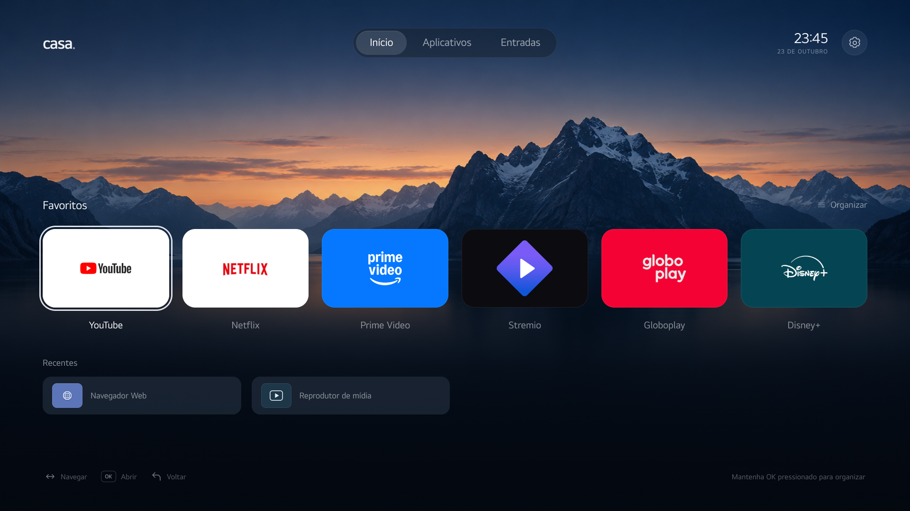
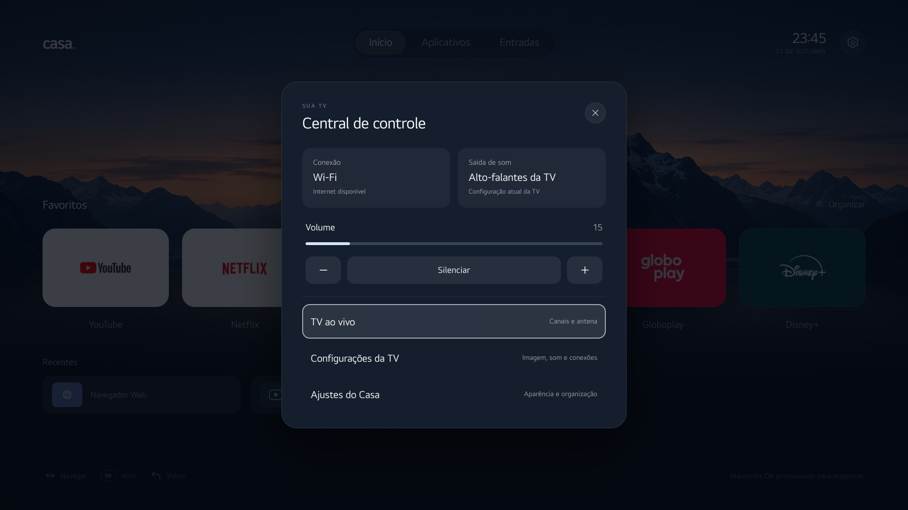

# Casa · launcher para webOS TV

Uma tela inicial limpa para abrir seus aplicativos e acessar os recursos da TV. O Casa combina navegação por controle remoto, favoritos e uma central de controle discreta, com uma direção visual inspirada na Apple TV.

**Versão 0.2.0 · projeto independente · compatibilidade experimental.**



[Baixar o IPK 0.2.0](https://github.com/SmookeyDev/casa-webos-launcher/releases/download/v0.2.0/com.soar.tv.launcher_0.2.0_all.ipk) · [Notas da versão](https://github.com/SmookeyDev/casa-webos-launcher/releases/tag/v0.2.0) · [Instalação detalhada](docs/INSTALLATION.md) · [Arquitetura](docs/ARCHITECTURE.md)

## O que o Casa faz

- **Favoritos:** até seis aplicativos, com ordem editável pelo controle remoto.
- **Aplicativos:** inventário nativo quando disponível, cache local e páginas de até 12 itens.
- **Recentes:** até quatro apps abertos pelo Casa que ainda não estão nos favoritos.
- **Entradas:** três portas HDMI com nome e estado informados pelo webOS.
- **Central de controle:** rede, saída de som, volume, mudo, TV ao vivo e acesso aos ajustes da LG.
- **Personalização:** movimento reduzido e opção de ocultar os nomes dos aplicativos.
- **Navegação persistente:** favoritos, preferências, aba, página e foco salvos localmente.

O fundo é estático. A interface usa HTML, CSS e JavaScript, sem framework, fontes remotas, vídeo de fundo ou filtros de desfoque. Os controles gráficos usam SVGs monocromáticos para evitar que a fonte da TV transforme símbolos em emojis.



## Antes de instalar

**O Casa é um aplicativo independente. O botão Home e a inicialização da TV continuam usando a Home LG.** A versão publicada não remapeia o controle, não instala autostart e não substitui componentes do firmware.

O Casa também não remove aplicativos, não desativa serviços do sistema e não instala bloqueadores de publicidade. A interface do próprio launcher não contém anúncios. Aplicativos abertos por ele mantêm suas funções, contas e políticas de publicidade.

### Compatibilidade comprovada

| Item | Ambiente validado |
| --- | --- |
| Televisor | LG **43UR7800PSA** |
| Plataforma | **webOS TV 25** |
| Versão do SDK reportada pela TV | **10.3.2** |
| Firmware | **33.31.75** |
| Motor web | Chromium 120 |
| Interface | Composição de 1920 × 1080; escala também verificada em 1280 × 720 |
| Integração completa | Testada nessa TV com acesso root já existente e permissão LS2 específica para o serviço do Casa |

Outros modelos, regiões e versões de firmware podem oferecer APIs ou permissões diferentes. A presença de webOS, por si só, não garante compatibilidade. O caminho de instalação pelo Developer Mode está documentado abaixo, mas a integração completa não foi validada em uma segunda TV sem root.

## Instalar o aplicativo

Baixe `com.soar.tv.launcher_0.2.0_all.ipk` na [release v0.2.0](https://github.com/SmookeyDev/casa-webos-launcher/releases/tag/v0.2.0). O pacote contém a interface e o serviço local `com.soar.tv.launcher.service`.

Escolha o procedimento correspondente ao estado atual da sua TV:

| Sua TV | Procedimento |
| --- | --- |
| Sem root | Use o [Developer Mode da LG](docs/INSTALLATION.md#1-tv-sem-root-developer-mode), uma conta LG Developer e a CLI oficial. Recursos privados podem permanecer indisponíveis. |
| Já possui root e Homebrew Channel | Use o acesso SSH e as ferramentas já configuradas, conforme o [fluxo para TV com root existente](docs/INSTALLATION.md#2-tv-com-root-já-existente). O Casa não inclui um método para obter root. |

Com a TV já cadastrada na CLI como `casa-tv`, os comandos de instalação e abertura são:

```sh
ares-install --device casa-tv ./com.soar.tv.launcher_0.2.0_all.ipk
ares-launch --device casa-tv com.soar.tv.launcher
```

O nome exibido na TV é **Casa**. O identificador técnico é `com.soar.tv.launcher`. A release é um download manual de IPK; não há publicação deste projeto em uma loja ou feed do Homebrew Channel.

O inventário completo exige uma permissão privada neste firmware. Há um [provisionamento opcional e reversível](docs/INSTALLATION.md#3-opcional-habilitar-o-catálogo-nativo) para quem já possui uma sessão root. Ele concede o grupo LS2 necessário somente à identidade do serviço: **o serviço continua executando no jail normal, sem root**.

## Usar com o controle remoto

| Ação | Resultado |
| --- | --- |
| Setas | Movem o foco entre aplicativos, abas, entradas e ações. |
| OK | Abre o item selecionado ou executa a ação em foco. |
| Manter OK por cerca de 650 ms sobre um app | Abre a organização de favoritos. |
| OK no organizador | Adiciona ou remove o aplicativo dos favoritos. |
| Esquerda/direita sobre um favorito no organizador | Altera sua posição. |
| Descer na última linha de aplicativos | Avança para a próxima página, quando houver. |
| Subir na primeira linha de aplicativos | Retorna à página anterior, quando houver. |
| Botões de página | Também permitem trocar de página sem percorrer toda a grade. |
| Voltar | Fecha o painel aberto; fora dele, retorna ao Início; no Início, entrega a saída ao webOS. |
| Engrenagem | Abre a central de controle. |

O ponteiro do Magic Remote também pode selecionar itens. A organização aceita até seis favoritos e mantém pelo menos um. A entrada HDMI pode ser aberta mesmo quando não há dispositivo detectado; estado desconhecido não é apresentado como desconectado.

Na central, **Ajustes do Casa** altera a aparência e os favoritos. **Configurações da TV** abre a interface nativa da LG para imagem, som e conexões. O painel mostra informações reais quando disponíveis; falhas ou falta de permissão aparecem como indisponibilidade, sem valores inventados.

### Preferências e recentes

Os dados ficam no armazenamento local do próprio app. Ao voltar de outro aplicativo, o Casa restaura o foco e reconcilia os inventários, com controle de chamadas repetidas. Uma resposta parcial do serviço preserva os favoritos e o último catálogo completo.

**Recentes significa aplicativos abertos pelo Casa.** Não representa histórico global da TV, episódios assistidos, progresso de reprodução ou a função Continuar assistindo de serviços de streaming. Favoritos não são repetidos nessa área.

Limpar os dados do aplicativo ou removê-lo pode apagar essa organização. O botão **Restaurar organização inicial** redefine os favoritos; não é uma restauração de fábrica da TV.

## Desenvolver e testar no computador

Requisitos: **Node.js 22.12 ou posterior**, npm e Git. Para os testes de interface, instale o Chromium usado pelo Playwright.

```sh
git clone https://github.com/SmookeyDev/casa-webos-launcher.git
cd casa-webos-launcher
npm ci
npx playwright install chromium
```

### Abrir a prévia

```sh
npm run dev
```

Abra [http://127.0.0.1:4187](http://127.0.0.1:4187). A prévia permite avaliar o layout e navegar. Abrir apps/HDMI produz somente uma mensagem de simulação; os controles de áudio ficam desativados. **O navegador no computador não se conecta à sua TV.**

### Verificar o comportamento

```sh
npm run verify
```

O comando inicia uma prévia local para os testes quando necessário. As duas suítes somam **30 verificações** de navegação, OK longo, escala em 720p, catálogo assíncrono e parcial, paginação, persistência, HDMI tardio, retorno rápido e isolamento da prévia. Elas usam um navegador e respostas nativas simuladas; não alteram a TV.

`npm run check` verifica sintaxe/JSON/versões e executa **15 testes do provisionador** e **12 testes do filtro de catálogo**, sem conectar à TV. O CI do GitHub executa essas verificações, as duas suítes de navegador e o empacotamento.

Se preferir um Google Chrome já instalado, use a variável `CASA_BROWSER_CHANNEL=chrome`; veja os exemplos para cada shell no [guia de instalação](docs/INSTALLATION.md#desenvolvimento-local-e-empacotamento).

### Gerar o IPK

```sh
npm run package
```

O resultado fica em `dist/com.soar.tv.launcher_0.2.0_all.ipk`. O empacotamento inclui `app/` e `services/com.soar.tv.launcher.service/`. Não é necessário instalar dependências npm na TV: o serviço utiliza o runtime disponibilizado pelo webOS.

## Integração e permissões

A interface web solicita lançamento de aplicativos pela API da plataforma. Um serviço local de métodos fixos fornece catálogo, estado da TV e controles de áudio. Ele valida a identidade do chamador Casa e não oferece execução de comandos, proxy Luna arbitrário ou servidor HTTP.

O grupo privado `applications.internal` pode ser necessário para descobrir apps e seus pontos de lançamento. No ambiente validado, ele foi concedido apenas ao serviço, por um script separado executado uma vez na sessão root já existente. Essa alteração não transforma o serviço em root, não remove o jail e não concede o grupo à interface web. O grupo é definido pelo firmware e pode permitir mais operações que as consultas usadas; os métodos fixos do serviço continuam sendo um limite importante. [Contrato nativo e permissões](docs/NATIVE-SERVICE.md).

APIs privadas e permissões são específicas do firmware. Quando a descoberta nativa falha, o Casa mantém o cache e tenta o catálogo empacotado, verificando os IDs conhecidos com `getAppLoadStatus`. Esse caminho não descobre sozinho todos os novos aplicativos. [Detalhes do contrato, cache e limites](docs/ARCHITECTURE.md).

O launcher não tem conta própria, backend remoto ou telemetria própria. Preferências ficam no app; a resposta de rede entregue à interface não inclui IP, SSID ou credenciais.

## Desempenho e validação real

Na LG descrita acima, a versão 0.2.0 apresentou média de **8,76 ms** no trecho síncrono do manipulador de navegação, em um teste com **20 movimentos sintetizados**.

Esse número **não mede FPS, latência física do controle remoto, tempo de abertura de aplicativos ou reprodução de vídeo**. É uma medição pequena e específica de desenvolvimento, não uma promessa de desempenho para outros modelos.

Também foram conferidos no hardware: catálogo de 16 apps/utilitários com ícones, estado de rede e áudio, mudanças de volume/mudo acompanhadas pelo painel, abertura de aplicativos e restauração do foco ao retornar. O estado inicial de áudio foi restaurado após a validação.

## Limitações atuais

- Compatibilidade de hardware comprovada somente no modelo e firmware informados.
- APIs privadas podem mudar ou negar acesso em outro firmware; a integração completa depende das permissões disponíveis.
- O fallback verifica um conjunto conhecido de apps e pode ficar incompleto sem catálogo nativo autorizado.
- O suporte a entradas está limitado às **três portas HDMI** do modelo validado.
- Um app recém-descoberto pode aparecer com iniciais quando seu ícone está bloqueado pelo jail e ainda não foi empacotado.
- Os nomes e o estado HDMI dependem dos dados fornecidos pelo webOS; o Casa não inventa nomes de dispositivos.
- Não há agregação de catálogos de streaming, sincronização de contas, histórico global ou controle de outros aparelhos.
- O Casa permanece um app independente, sem substituição da Home LG ou inicialização automática.

## Perguntas frequentes

**Preciso obter root para abrir o Casa?**

O caminho oficial de instalação de apps é o Developer Mode. O Casa pode usar recursos limitados quando a plataforma recusa APIs privadas. A integração completa desta versão foi comprovada somente no ambiente com root já existente e permissão específica; este repositório não ensina nem executa root.

**Por que o botão Home ainda abre a LG?**

Esse é o comportamento esperado da versão 0.2.0. Abra o Casa pela lista de apps ou pela CLI. Voltar no Início também usa a saída nativa, que pode exibir a confirmação do webOS.

**Instalei e faltam aplicativos ou o painel mostra Indisponível.**

Abra um app conhecido para confirmar o lançamento. Depois consulte [diagnóstico e permissões](docs/INSTALLATION.md#diagnóstico). Inventário incompleto, API recusada e falta de ícone são situações diferentes. Reinstalar o IPK pode exigir reaplicar o provisionamento opcional.

**O app novo está com duas letras no lugar do ícone.**

É o fallback visual. O app ainda pode ser aberto. O serviço só lê imagens dentro de caminhos permitidos e pode ser impedido pelo jail; uma atualização de recursos pode fornecer o ícone depois.

**Ao reabrir, o Casa parece ter ficado em segundo plano.**

Use o pacote atual. `handlesRelaunch:false` permite que o webOS gerencie a ativação da janela; trocar esse campo sem implementar a ativação exigida pela plataforma pode deixar o app no fundo. [Ciclo de vida oficial da LG](https://webostv.developer.lge.com/develop/guides/app-lifecycle-management).

**Por que o npm mostra avisos ao instalar as ferramentas?**

A CLI oficial webOS 3.2.6 fixa dependências transitivas no próprio shrinkwrap. A auditoria deste lockfile reporta alertas nessas ferramentas, inclusive um crítico; `npm audit fix` não os resolveu sem trocar a versão da CLI. Essas dependências rodam no computador para desenvolvimento/empacotamento e não são incluídas no runtime do IPK. O projeto conserva a versão da CLI validada e não executa atualizações forçadas automaticamente. Isso não equivale a uma auditoria de segurança completa do projeto.

**Como desfazer tudo?**

Se aplicou a permissão opcional, execute primeiro o script com `--restore`. Depois remova `com.soar.tv.launcher` pela CLI ou pelo gerenciador usado na instalação. Há [instruções completas de reversão](docs/INSTALLATION.md#4-reverter-permissões-e-desinstalar). Como Home e boot não são alterados, não há configuração de launcher padrão para restaurar.

## Documentação e contribuição

- [Instalação, provisionamento opcional, reversão e diagnóstico](docs/INSTALLATION.md)
- [Arquitetura, APIs, persistência e limites de execução](docs/ARCHITECTURE.md)
- [Contrato do serviço nativo e detalhes do provisionamento LS2](docs/NATIVE-SERVICE.md)
- [Relatar um problema](https://github.com/SmookeyDev/casa-webos-launcher/issues)

Ao relatar compatibilidade, informe modelo completo, região, versão de firmware, SDK reportado, método de instalação e passos para reproduzir. Não envie chaves SSH, senhas, passphrases ou dados da sua rede.

## Licença e marcas

A licença de uso e redistribuição do código **ainda não foi definida pelo autor**. A publicação do repositório não deve ser interpretada como concessão de uma licença de software livre. Consulte o autor antes de redistribuir ou incorporar o código.

LG, webOS, Apple TV e as marcas/ícones de aplicativos pertencem aos respectivos titulares. A inspiração visual e a inclusão de ícones não indicam afiliação ou endosso. Os ícones de terceiros não recebem uma licença de redistribuição por meio deste projeto; consulte também os avisos de atribuição do repositório.
