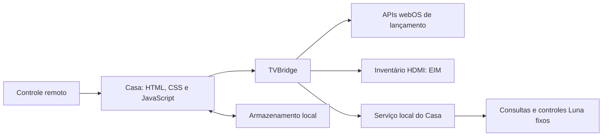

# Arquitetura e limites do Casa

[Voltar ao README](../README.md) · [Instalação e reversão](INSTALLATION.md) · [Contrato nativo completo](NATIVE-SERVICE.md)

O Casa 0.2.0 tem duas partes no mesmo IPK: uma interface web e um serviço JavaScript local. Não depende de um servidor no computador ou de uma API em nuvem para funcionar na TV.

## Componentes

| Caminho | Responsabilidade |
| --- | --- |
| `app/index.html` | Estrutura, abas, painéis e controles acessíveis. |
| `app/styles.css` | Layout 1920 × 1080, escala, estados de foco e movimento reduzido. |
| `app/js/app.js` | Navegação, favoritos, recentes, paginação e ciclo de vida. |
| `app/js/webos-bridge.js` | Ponte com webOS, timeout/cancelamento e fallback de inventários. |
| `app/js/catalog.js` | Catálogo empacotado que permite apresentação imediata. |
| `services/com.soar.tv.launcher.service/` | Serviço local de integração e recursos de ícones permitidos. |
| `scripts/` | Ferramentas de desenvolvimento, empacotamento, testes e provisionamento opcional. |

O app ID é `com.soar.tv.launcher`. O serviço é `com.soar.tv.launcher.service`. A UI solicita `applications.launcher` em seu `appinfo.json`; isso não equivale a autorização para qualquer método privado.

## Serviço local: contrato fechado

O serviço utiliza o runtime Node/webos-service já fornecido pela plataforma. Ele continua na identidade de serviço comum e no jail do webOS, inclusive quando o IPK foi instalado por SSH/root.

Todos os métodos conferem `message.sender === "com.soar.tv.launcher"`. O manifesto os declara privados. Cinco métodos aceitam somente parâmetros vazios e não aceitam assinaturas; a exceção é a assinatura explícita de volume.

| Método | Entrada aceita | Função |
| --- | --- | --- |
| `getCatalog` | `{}` | Combina aplicativos e pontos de lançamento visíveis; retorna inventário filtrado, ícones permitidos, disponibilidade e falhas parciais. |
| `getTVStatus` | `{}` | Lê volume, mudo, saída de áudio e estado resumido de rede. Campos indisponíveis usam `null`. |
| `volumeUp` | `{}` | Sobe um passo e tenta reler o estado. |
| `volumeDown` | `{}` | Desce um passo e tenta reler o estado. |
| `toggleMute` | `{}` | Lê o mudo atual e envia sua inversão. |
| `watchVolume` | `{subscribe:true}` em assinatura real | Entrega mudanças de volume/mudo enquanto a central está aberta e visível. |

Não há método para executar shell, fornecer uma URI Luna arbitrária, ler um caminho arbitrário ou encaminhar parâmetros livres para a plataforma. O serviço não possui servidor HTTP nem endpoint de lançamento genérico. Chamar seus métodos como root pelo terminal pode ser recusado: a identidade root não é o chamador Casa aceito pelo contrato.

`getTVStatus` entrega somente conexão local, tipo de enlace e estado de internet informado pela TV. Não repassa SSID, IP, senha ou a resposta nativa inteira. Disponibilidade de leitura de áudio não garante que uma tentativa posterior de controle será autorizada; a ação pode retornar erro próprio.

## APIs da plataforma

Lançamento e verificação de IDs conhecidos utilizam `com.webos.applicationManager/launch` e `getAppLoadStatus`. São métodos documentados no [Application Manager da LG](https://webostv.developer.lge.com/develop/references/application-manager).

As demais integrações dependem do firmware:

| Função | Consultas usadas no ambiente validado |
| --- | --- |
| Catálogo | `com.webos.applicationManager/listApps` e `listLaunchPoints` |
| Volume pontual | `com.webos.audio/getVolume` |
| Mudanças de volume | `com.webos.service.audio/master/getVolume` com assinatura |
| Saída de som | `com.webos.service.audio/getSoundOutput`, com alternativa fixa via settings |
| Rede | `com.webos.service.connectionmanager/getstatus`, com alternativa fixa `com.palm.connectionmanager/getStatus` |
| Controle de áudio | `com.webos.audio/volumeUp`, `volumeDown` e `setMuted` |
| HDMI | `com.webos.service.eim/getAllInputStatus`, consultado pelo bridge |

Os controles de áudio constam na [documentação pública Audio da LG](https://webostv.developer.lge.com/develop/references/audio). Os métodos de leitura e outras URIs acima não devem ser considerados contratos universais da TV apenas porque aparecem em código ou na documentação do webOS Open Source Edition.

Neste firmware, `com.webos.audio/getVolume` respondeu à leitura inicial, mas não entregou alterações subsequentes em uma assinatura. Por isso o watch usa `com.webos.service.audio/master/getVolume`, cuja resposta foi validada no próprio aparelho. Essa decisão pode exigir revisão em outro modelo.

### Permissão opcional de catálogo

Na TV validada, as consultas completas de catálogo exigiram o grupo LS2 `applications.internal`. O provisionamento separado adiciona esse grupo somente à identidade do serviço do Casa, por meio dos arquivos LS2 do pacote instalado. O grupo é definido pela plataforma e pode permitir operações além das duas consultas utilizadas; ele não é uma autorização restrita a duas URIs.

Essa concessão **não eleva o processo a root**, não remove seu jail e não concede acesso direto à UI web. O script precisa de uma sessão root já existente para editar o registro de permissões; ele não participa da execução normal do launcher. Instruções, parâmetros, backup e `--restore` estão no [guia de instalação](INSTALLATION.md#3-opcional-habilitar-o-catálogo-nativo).

## Inventário, cache e respostas parciais

A UI apresenta imediatamente o catálogo em cache ou o conjunto empacotado. A consulta nativa acontece em paralelo, sem bloquear a apresentação da tela.

1. Uma resposta completa do serviço se torna a fonte principal e atualiza o último snapshot completo.
2. Uma resposta `native-partial` é combinada com os itens anteriores. Ela não prova que um app omitido foi desinstalado, portanto preserva favoritos e cache anteriores.
3. Se o serviço falhar, o bridge tenta a listagem permitida ao contexto e depois verifica os IDs do catálogo conhecido por `getAppLoadStatus`, com até quatro chamadas simultâneas.
4. Um fallback limitado não descobre IDs novos sozinho e não deve apagar um favorito externo apenas por desconhecê-lo.

O serviço combina apps e launch points e filtra itens ocultos, serviços e placeholders, o próprio Casa e categorias previamente excluídas do catálogo, como publicidade e assistentes. Esse filtro só determina o que o Casa exibe: ele não remove ou desativa componentes da TV. Há exceções explícitas para utilitários úteis, como TV ao vivo, navegador, mídia e Apps.

No hardware validado, o inventário final teve 16 apps/utilitários. Essa contagem descreve a TV de desenvolvimento; não é a quantidade de aplicativos que outra instalação precisa ter.

## Imagens

Quando possível, os ícones vêm do inventário nativo. A leitura aceita somente imagens PNG/JPEG/WebP em raízes permitidas e dentro da pasta do próprio app. Há verificação de caminho real, assinatura binária, arquivo regular e abertura sem seguir o symlink final.

Os limites incluem 96 apps, 128 KiB por imagem, 1,5 MiB de dados de imagem, dois leitores e prazo de leitura. SVG, URLs remotas e caminhos fornecidos livremente pelo cliente não são aceitos.

Se o jail bloquear um arquivo de outro app, o serviço tenta o PNG empacotado em sua própria pasta `icons/`, com ID validado. Quando nenhuma imagem é legível, a interface mostra iniciais. Descoberta do app e acesso à sua imagem são permissões diferentes: um app com iniciais ainda pode funcionar normalmente.

## Persistência e navegação

`casa.launcher.v1` armazena favoritos, ordem, aparência, últimos apps abertos pelo Casa, aba, página e foco. `casa.catalog.v1` armazena o último catálogo completo. Tudo fica no armazenamento local da origem do app, sem sincronização entre aparelhos.

Os recentes guardam IDs de lançamentos feitos pelo Casa; a interface exibe até quatro que não são favoritos. Eles não consultam o histórico global do sistema nem o histórico dos serviços de streaming.

As setas usam índices de grade no conteúdo principal. A linha incompleta aceita movimento vertical para o último item disponível, e a troca de página procura preservar a coluna. O organizador permite adicionar/remover favoritos e trocar sua posição. A gravação do foco é adiada por 350 ms para evitar escrita síncrona a cada tecla.

O Casa utiliza `handlesRelaunch:false`. O webOS ativa a janela quando o app é reaberto; eventos de retorno restauram o foco e atualizam a UI. Declarar que o app trata a reabertura sem implementar a ativação exigida pode deixá-lo em segundo plano. [Ciclo de vida de apps — LG](https://webostv.developer.lge.com/develop/guides/app-lifecycle-management).

Home e inicialização automática não são interceptados. O botão Voltar fecha painéis, retorna ao Início e entrega a saída ao comportamento nativo da plataforma. [Botão Voltar — LG](https://webostv.developer.lge.com/develop/guides/back-button).

## Trabalho limitado e assinatura de áudio

- Consultas Luna pontuais têm timeout de 1,8 s no serviço; alternativas de rede/saída podem aumentar o tempo total do status.
- Pedidos simultâneos compartilham a consulta em andamento. O catálogo tem cache curto de 30 s e o status de 1 s.
- Retornos próximos do app são coalescidos: o refresh de inventários tem intervalo mínimo de 10 s, e a apresentação dos recentes/foco não espera esse intervalo.
- O relógio usa atualização por minuto; não há polling contínuo de métricas ou inventários.
- O watch de áudio aceita até dois clientes, exige resposta inicial em 2 s e é cancelado ao fechar a central ou ocultar o app.
- Erro ou encerramento termina a assinatura, sem polling ou reconexão automática em segundo plano.
- Ações de áudio concorrentes ou repetidas em menos de 120 ms são recusadas como ocupadas.
- Se a ação de áudio funcionar e a releitura falhar, o retorno é parcial; o serviço não repete automaticamente uma ação já executada.

## Validação e interpretação do desempenho

As suítes de navegador executam 30 verificações com catálogo e APIs simulados, incluindo 25 apps em três páginas, catálogo parcial, foco HDMI após resposta tardia, retorno rápido, controle direcional, prévia inativa e escala em 720p. Os testes de navegador não concedem permissões, não controlam a TV e não substituem a validação no aparelho.

No modelo e firmware informados no README, a integração foi confirmada dentro do próprio Casa, com o serviço comum no jail: catálogo, ícones, rede, som, lançamentos, retorno e assinatura de volume/mudo. O áudio foi restaurado após os testes.

Um perfil de 20 movimentos sintetizados na TV, com a versão 0.2.0, mediu **8,76 ms de média no manipulador síncrono de navegação**. Esse resultado exclui transporte do controle, renderização completa, compositor, FPS de vídeo e tempo de abertura de apps. Não permite inferir desempenho universal ou uma diferença perceptível a partir de pequenas variações entre execuções.

## Referências para desenvolvimento

- [Uso de serviços JavaScript — LG](https://webostv.developer.lge.com/develop/guides/js-service-usage)
- [Manifesto services.json — LG](https://webostv.developer.lge.com/develop/references/services-json)
- [API webos-service — LG](https://webostv.developer.lge.com/develop/references/webos-service-reference)
- [Eventos webOS — LG](https://webostv.developer.lge.com/develop/references/webos-event)
